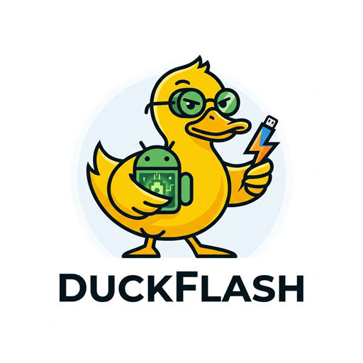
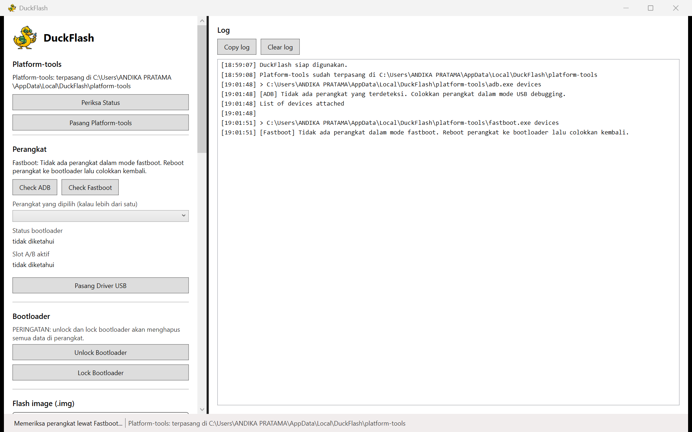
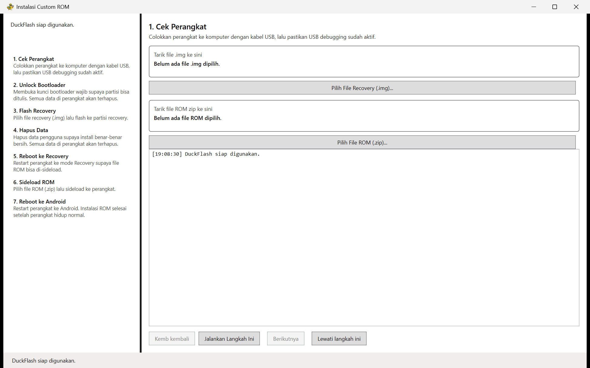
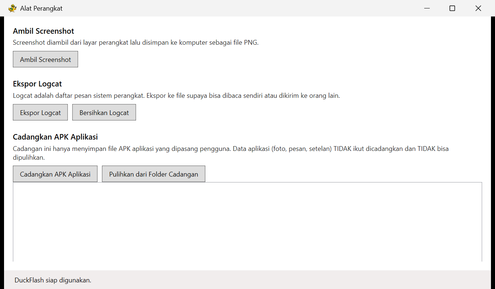

# DuckFlash



Tool desktop Windows untuk membantu pemula mengoprek Android (custom ROM, custom recovery)
**tanpa perlu mengetik command `adb` atau `fastboot`**. Tinggal klik tombolnya.

Dibuat dengan C# dan WPF (.NET 8), lisensi MIT, proyek open source.

Versi saat ini: **v1.0.0**

## Tampilan

Jendela utama. Semua tombol aksi di kiri, panel log live di kanan. Baris yang diawali
`> ` adalah command asli yang sedang dijalankan.



Wizard instalasi custom ROM: tujuh langkah dari cek perangkat sampai reboot ke Android.



Alat perangkat: screenshot, ekspor logcat, dan cadangan/pemulihan aplikasi.



## Kenapa DuckFlash?

Belajar flashing Android biasanya dimulai dari mencari tutorial command terminal yang
panjang, lalu mengetik satu per satu sambil berdoa tidak salah ketik. Satu huruf yang
salah bisa membuat perangkat gagal menyala.

DuckFlash menyediakan tombol-tombol jelas untuk hal yang paling sering dilakukan:

- Pasang **platform-tools** dan **driver USB Google** sendiri, tanpa download manual
- Cek perangkat yang terhubung (ADB dan Fastboot)
- Lihat info perangkat: model, codename, versi Android, status bootloader, slot A/B
- Pilih perangkat kalau ada lebih dari satu (semua command otomatis pakai `-s <serial>`)
- **Unlock / lock bootloader** dengan peringatan besar bahwa data akan terhapus
- Flash file `.img` ke partisi yang dipilih
- Sideload package `.zip` dari recovery
- Install file `.apk`
- Reboot ke system, recovery, bootloader, atau fastbootd
- **Wizard instalasi custom ROM** langkah demi langkah, dari cek perangkat sampai ROM hidup
- **Debloater**: hapus aplikasi yang tidak diperlukan dengan centang
- **Alat perangkat**: ambil screenshot, ekspor logcat, cadangan/pemulihan aplikasi
- Cek versi terbaru dari GitHub Releases
- Bahasa Indonesia / English (ganti di menu **Pengaturan**)
- Lihat **command asli** yang dijalankan, live di panel log

## ⚠️ Disclaimer Risiko

**Pengguna sendiri yang bertanggung jawab atas semua risiko yang muncul.**

Memasang custom ROM, flash partisi, unlock bootloader, atau menghapus data bisa
membuat perangkat Anda mati total (brick), kehilangan semua data, atau tidak bisa
menyala sama sekali. Beberapa perangkat bisa saja brick karena kesalahan pengguna,
file yang rusak, atau kabel USB yang putus di tengah jalan.

- Selalu **backup data** Anda sebelum melakukan flashing apa pun.
- Pastikan file yang Anda flash **cocok dengan model perangkat** Anda.
- Pastikan hash SHA256 file cocok dengan hash yang dipublikasikan developer.
- Gunakan file dari sumber tepercaya.
- DuckFlash sengaja **memblokir flash** kalau bootloader terdeteksi terkunci, dan
  selalu meminta konfirmasi sebelum menjalankan perintah yang berisiko.

Proyek ini menyediakan alat bantu, bukan jaminan hasil.

## ⚠️ Catatan Antivirus

Aplikasi seperti DuckFlash (yang menjalankan `adb`/`fastboot`, mengubah partisi, dan
membuat proses elevate privilege) **sering dianggap mencurigakan** oleh antivirus,
terutama Kaspersky, ESET, dan beberapa antivirus lainnya.

Ini adalah **false positive** yang dikenal. Aplikasi ini open source dan bisa Anda
periksa sendiri kodenya. Kalau antivirus memblokir, tambahkan pengecualian untuk file
`DuckFlash.exe` sesuai panduan antivirus Anda.

## Cara Pakai

### 1. Instal

Unduh `DuckFlash.exe` dari halaman [Releases](https://github.com/zee2434/DuckFlash/releases),
=======
Unduh `DuckFlash.exe` dari halaman [Releases](https://github.com/Dikdikduck/DuckFlash/releases),
>>>>>>> 15c381f (DuckFlash v1.0.0)
lalu jalankan. Tidak perlu instalasi, tidak perlu Python, tidak perlu .NET runtime
(versi rilis sudah self-contained).

### 2. Sambungkan perangkat

1. Aktifkan **Opsi pengembang** lalu nyalakan **USB debugging** di perangkat.
2. Colokkan kabel USB ke komputer.
3. Tekan **Periksa Status** untuk memastikan platform-tools sudah terpasang.
   Kalau belum, klik **Pasang Platform-tools** — aplikasinya mengunduh sendiri dari
   repository resmi Google.
4. Kalau perangkat tidak terdeteksi, klik **Pasang Driver USB** (butuh hak
   Administrator, hanya diminta saat fitur ini dipakai).

### 3. Cek perangkat

Klik **Check ADB** untuk melihat perangkat yang terhubung lewat ADB, atau
**Check Fastboot** kalau perangkat sedang dalam mode bootloader.

Kalau terdeteksi lebih dari satu perangkat, pilih serial di dropdown
**Perangkat yang dipilih**. Semua command otomatis memakai flag `-s <serial>`.

### 4. Flash recovery

1. Tarik file `.img` ke kotak **Tarik file .img ke sini** (atau klik
   **Pilih File .img...**).
2. Pilih partisi tujuan: `recovery`, `boot`, `vendor_boot`, `init_boot`, `vbmeta`,
   atau `dtbo`.
3. Periksa **SHA256** yang ditampilkan. Kalau developer menyediakan hash, ketik di kolom
   **Hash dari developer** lalu klik **Bandingkan Hash**.
4. Klik **Flash**. Akan muncul dialog konfirmasi yang menyebut nama partisi dan nama
   file. Pastikan sudah benar, baru tekan OK.

### 5. Sideload

1. Tarik file `.zip` ke kotak **Tarik file .zip ke sini**.
2. Pastikan perangkat sudah dalam mode recovery.
3. Klik **Sideload**, lalu konfirmasi.

### 6. Install APK

Tarik file `.apk` ke kotak **Tarik file .apk ke sini**, lalu klik **Install APK**.
Berguna buat tes APK hasil build sendiri sebelum rilis.

### 7. Reboot

Tombol **Reboot System / Recovery / Bootloader / Fastbootd** untuk berpindah mode.

## Fitur Lanjutan

### Wizard Instalasi Custom ROM

Tombol **Mulai Instalasi Custom ROM** membuka wizard tujuh langkah: cek perangkat →
unlock bootloader → flash recovery → hapus data → reboot ke recovery → sideload ROM →
reboot ke Android. Setiap langkah punya tombol **Jalankan Langkah Ini**, **Lewati
Langkah Ini**, dan **Kembali**, jadi Anda bisa menyela kalau ada yang error.

### Debloater

Tombol **Buka Debloater** menampilkan daftar aplikasi yang bisa dicentang, lalu
menghapus yang Anda pilih dengan `adb shell pm uninstall --user 0`. Yang terhapus hanya
data untuk pengguna utama — aplikasinya masih bisa dikembalikan dari Play Store.
Centang **Tampilkan aplikasi sistem** kalau ingin melihat semuanya.

### Alat Perangkat

Tombol **Buka Alat Perangkat** menggabungkan tiga hal:

- **Ambil Screenshot** — Ambil layar perangkat, simpan sebagai file PNG di komputer.
- **Ekspor Logcat** — Simpan log sistem perangkat ke file teks, atau bersihkan buffer
  logcat di perangkat.
- **Cadangkan / Pulihkan Aplikasi** — Tarik file APK aplikasi yang dipasang pengguna ke
  folder di komputer, lalu pasang kembali dari folder itu kapan saja.

> ⚠️ Cadangan di sini **hanya menyimpan file APK**. Data aplikasi (foto, pesan, setelan)
> **tidak ikut dicadangkan** dan **tidak bisa dipulihkan** lewat fitur ini. Untuk backup
> data aplikasi yang sungguhan, pakai Google Backup atau layanan lain.

## Panel Log

Semua output `adb` dan `fastboot` ditampilkan live di panel kanan, termasuk
command lengkap yang sedang dijalankan (diawali `> `). Tombol **Copy log** dan
**Clear log** tersedia kalau Anda perlu mengirim log ke orang lain.

Kalau command gagal, DuckFlash ikut menampilkan penjelasan dan saran solusinya dalam
bahasa Indonesia, jadi tidak perlu dekut error mentah.

## Yang Tidak Bisa Dilakukan

- **ADB wireless pairing** (`adb pair` / `adb connect`) belum ada. Percakapan lewat
  Wi-Fi harus dilakukan manual lewat command prompt untuk sekarang.
- **Backup data aplikasi** belum ada. Fitur cadangan hanya menyimpan file APK, bukan
  isi aplikasi (lihat bagian Alat Perangkat di atas).
- **Hanya Windows**. Belum ada versi macOS atau Linux.
- **Pemasangan driver USB butuh hak Administrator**, jadi jalankan Windows-nya sebagai
  Administrator atau setujui dialog UAC saat diminta.

## Build dari Source

Butuh .NET 8 SDK.

```powershell
git clone https://github.com/zee2434/DuckFlash.git
=======
git clone https://github.com/Dikdikduck/DuckFlash.git
>>>>>>> 15c381f (DuckFlash v1.0.0)
cd DuckFlash
dotnet build DuckFlash.sln -c Release
dotnet test DuckFlash.sln
```

Untuk membuat `.exe` single-file yang bisa dibagikan:

```powershell
.\scripts\publish.ps1
```

Hasilnya ada di `artifacts\publish\DuckFlash.exe`, lengkap dengan file
`DuckFlash.exe.sha256` untuk-checking integritas.

## Struktur Proyek

```
src/DuckFlash/
  Models/        data murni (DeviceInfo, CommandResult, dll)
  Services/      logika: ToolsDownloader, AdbService, FastbootService, DriverService, ErrorTranslator
  ViewModels/    state dan command UI
  Views/         XAML
  Resources/     teks, ikon, daftar terjemahan error
tests/DuckFlash.Tests/
assets/          sumber desain logo
docs/            gambar untuk README
scripts/         publish.ps1 dan make-logo-assets.ps1
```

Logika aplikasi tidak ada di code-behind XAML, dan semua pemanggilan proses
lewat `Services` supaya bisa diuji dengan mock.

## Lisensi

MIT. Lihat [LICENSE](LICENSE).

## Repo

=======
<https://github.com/zee2434/DuckFlash>
>>>>>>> 15c381f (DuckFlash v1.0.0)
